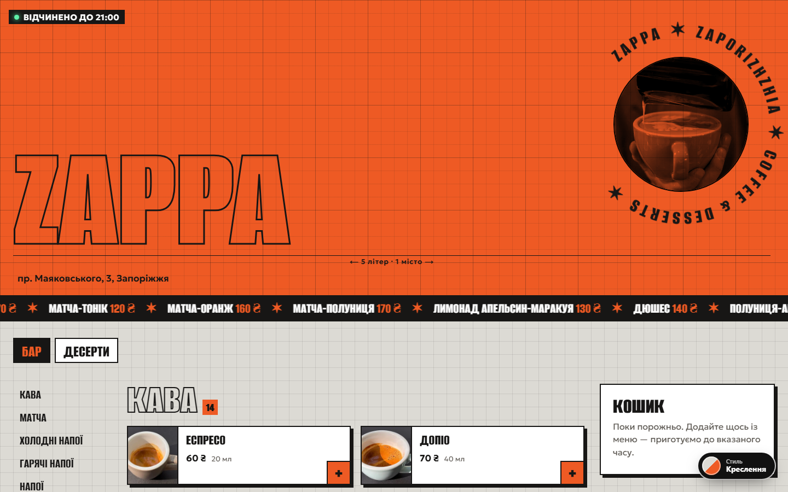
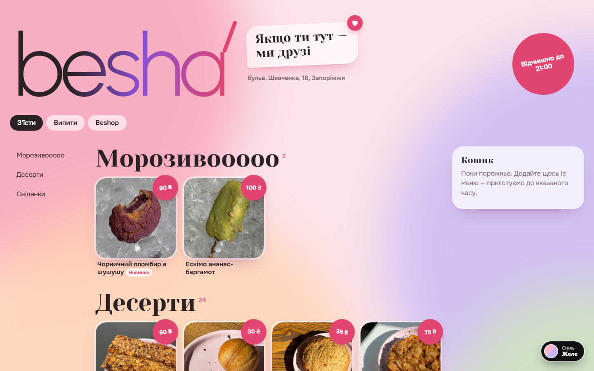
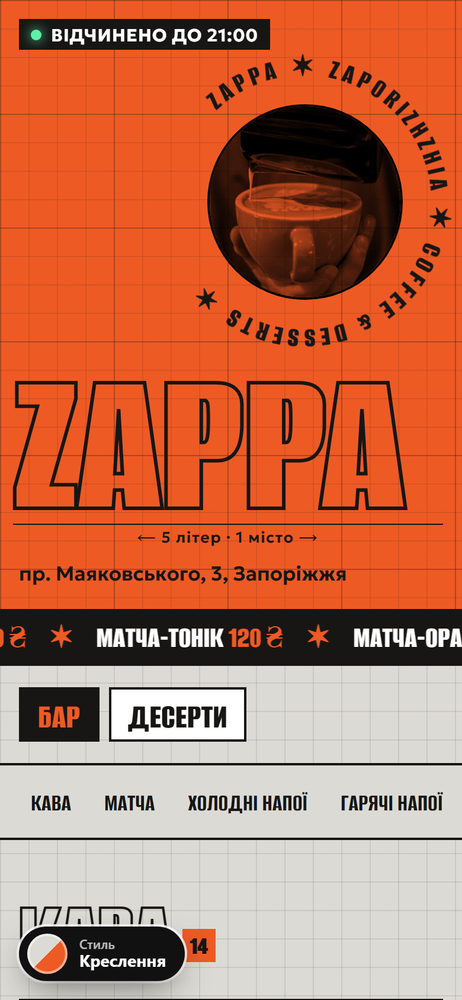
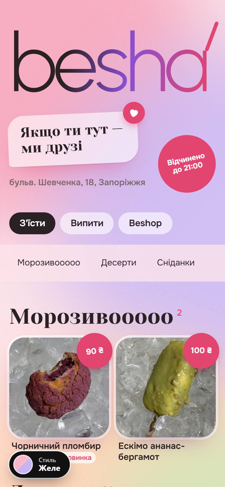

# ZAPPA & beshá — menu sites for two coffee shops

Demo for two coffee shops in Zaporizhzhia: each has its own bold visual identity, the real menu, a "to go" cart with pickup time, and orders sent to Telegram. A bot lets the owners edit the menu themselves.

**Live:** https://zappa-besha.pages.dev

| ZAPPA — industrial poster | beshá — soft pink |
|---|---|
|  |  |
|  |  |

## What it does

- Two separate designs for two brands, plus a switcher between 5 styles each
- Menu with photos, prices and categories, cart with pickup time
- Orders go to Telegram with "accepted" / "ready" buttons
- Telegram admin bot for both shops: prices, items, photos, stop-list
- Desktop layout: categories on the left, sticky cart on the right
- Free hosting, no monthly fees

## Stack

JavaScript, Cloudflare Pages + Functions, Cloudflare D1, Telegram Bot API

> Source code is private. Want a site like this for your business? Message me.
